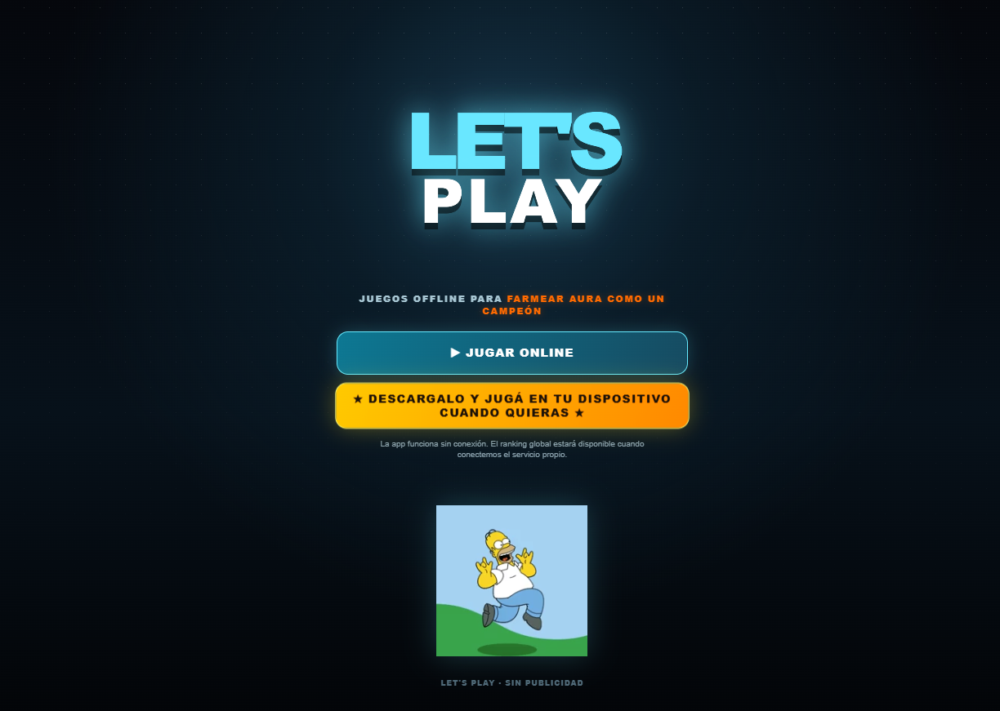
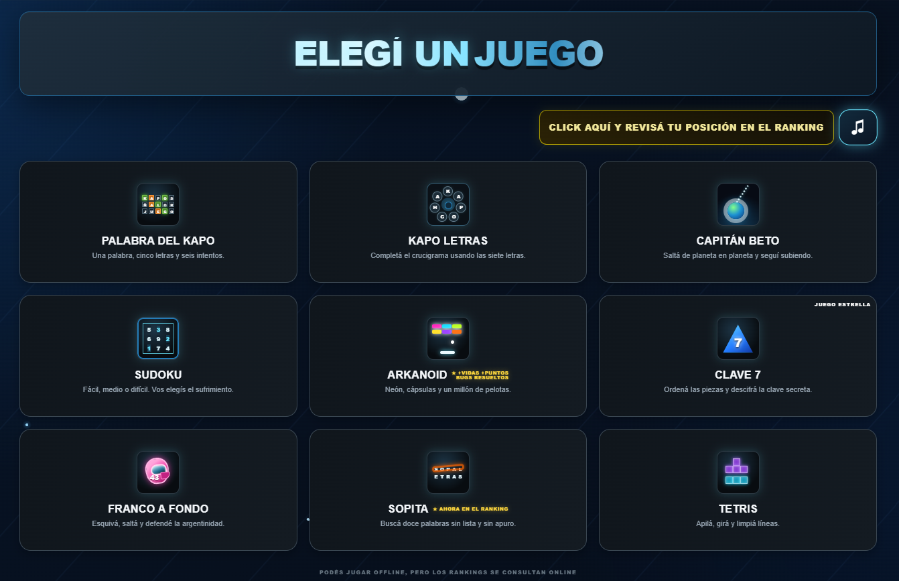

# 🎮 Let's Play

A static collection of browser games, based and adapted from the public `kpocha31-rgb/Facu-games` repository.

## 🗂️ Project layout

This structure separates the app by responsibility and keeps each game's code in its own module. That makes the project easier to modify and maintain, and lets it scale as we add games or features without having to reorganize the whole app.

- 🏠 `index.html`: installable landing page.
- 🕹️ `games.html`: game menu and shared dialogs.
- 🎨 `css/`: landing and game styles.
- ⚙️ `js/app/`: landing behavior.
- 🎲 `js/games/`: game code and the Wordle dictionary.
- 🔌 `js/services/`: ranking client and service worker registration.
- 📊 `apps-script/`: source for a separate Apps Script ranking service.

The games run in the browser. There is no build step; GitHub Pages can serve the repository root directly.

## 💻 Local preview

Serve the repository root through a local HTTP server, then open `index.html`. Service workers require HTTPS or localhost; opening the files directly with `file://` will not enable offline installation.

## 🏆 Global ranking

The client does not contact the original project's Apps Script. The ranking endpoint is blank in `js/config.js`, so score submissions are disabled until a new service is deployed. `apps-script/Code.gs` implements the matching `ranking` and `submit` JSONP actions and creates its own spreadsheet when `setup()` is run once from the Apps Script editor. The spreadsheet has a `Ranking` tab for current best scores and a private `ScoreAttempts` tab for accepted submissions, including submissions that did not improve a player's record. Some boundary scores are flagged for review.

After deploying the script as a web app, add its URL to `rankingEndpoint` in `js/config.js`. The service validates the game, nickname, device ID, integer score ranges, and a per-device cooldown. Since the endpoint accepts browser-supplied scores, these checks reduce basic abuse but cannot prove that a score came from an unmodified game client.

## 🚀 GitHub Pages

Publish the repository root with GitHub Pages. The service worker precaches the app shell and local game files for offline use. Its cache names are scoped to this app so activation does not delete other apps' caches on the same origin.

## 📸 Screenshots from the First Attempt

### Landing page

### Game menu

